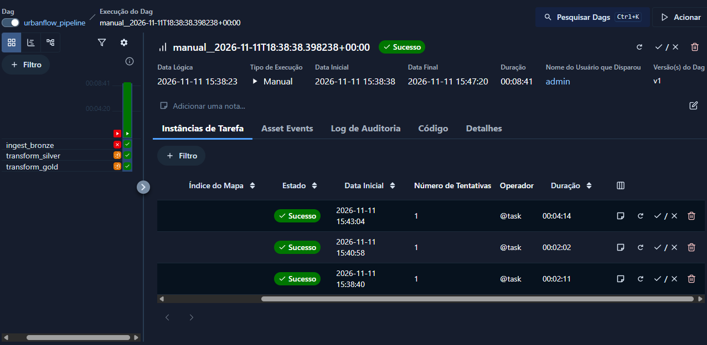

# UrbanFlow — Data Lakehouse Pipeline

An end-to-end data engineering project that processes NYC Yellow Taxi trip data using **PySpark, Delta Lake, and Apache Airflow**.

UrbanFlow implements a Bronze → Silver → Gold architecture to ingest, validate, transform, and aggregate mobility data, turning raw records into structured datasets for analytical purposes.

## Architecture

The project follows a Medallion Architecture:

- **Bronze:** Ingests raw NYC Yellow Taxi data into the data lake.
- **Silver:** Cleans and validates records, applying data quality rules and referential integrity checks.
- **Gold:** Produces analytical aggregations and mobility metrics, including trip patterns, temporal trends, and geographic insights.

## Tech Stack

- **Python** — pipeline development
- **PySpark** — distributed data processing
- **Delta Lake** — reliable data storage
- **Apache Airflow** — workflow orchestration
- **Docker & Docker Compose** — containerized environment
- **PostgreSQL & Redis** — Airflow metadata and Celery infrastructure
- **Pytest** — automated testing
- **Git & GitHub** — version control

## Data Source

The project uses NYC Yellow Taxi trip records for July 2026, provided in Parquet format, along with a taxi zone lookup dataset for geographic reference.

The pipeline processes more than **3.5 million raw records**.

## Data Quality

The Silver layer applies validation rules to improve data reliability, including:

- Mobility-related business rules.
- Temporal consistency checks.
- Referential integrity validation.
- Identification and separation of invalid records.

## Key Results

The processing pipeline produced the following results:

- **3.53 million** raw records processed.
- **2.42 million** records classified as valid in the Silver layer.
- **1.1 million** records classified as invalid.
- Average trip distance: **2.98 miles**.
- Average trip duration: approximately **15.4 minutes**.
- Busiest recorded hour: **6 PM**.

## Workflow Orchestration

The pipeline is orchestrated through an Apache Airflow DAG, with three sequential tasks:

1. `ingest_bronze`
2. `transform_silver`
3. `transform_gold`

The workflow was successfully executed using Docker Compose and Airflow's CeleryExecutor.



## Project Structure

```text
urbanflow-data-lakehouse/
├── assets/
│   └── imgs/
├── dags/
│   └── urbanflow_pipeline.py
├── data/
│   └── reference/
├── docs/
├── notebooks/
│   └── data_exploration.py
├── scripts/
├── src/
│   ├── ingestion/
│   ├── quality/
│   └── transformations/
├── tests/
├── Dockerfile
├── docker-compose.yaml
├── requirements.txt
├── .gitignore
└── README.md
```

## Running the Project

The project uses Docker Compose to set up the Airflow environment.

```bash
# Build the custom Airflow image
docker compose build

# Initialize Airflow
docker compose up airflow-init

# Start the services
docker compose up -d
```

Access the Airflow interface at:

```text
http://localhost:8082
```

Trigger the `urbanflow_pipeline` DAG to execute the workflow.

## Project Goals

This project was developed to explore and apply core data engineering concepts, including distributed processing, data quality, lakehouse architecture, workflow orchestration, and containerization.